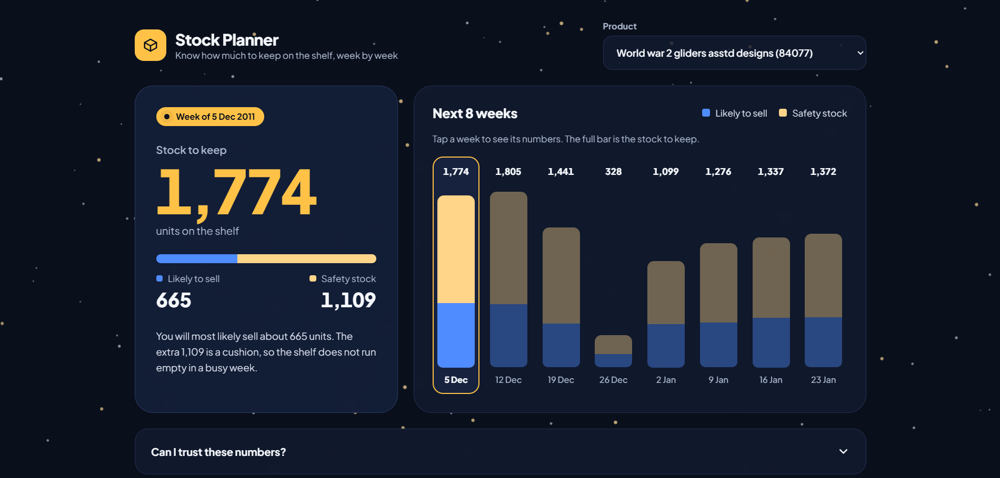

# 📦 Weekly Demand Forecasting — Stock Planner

Forecast how many units of each product a UK online gift retailer will sell in each of the **next 8 weeks**, and turn that forecast into a simple stock decision: **how much stock to keep**.

🔗 **Live app:** https://demand-forecasting-o8yb.onrender.com
📄 **API docs:** https://demand-forecasting-o8yb.onrender.com/docs

> The app runs on Render's free plan. If nobody has used it for a while, the first load can take 30–60 seconds while the server wakes up.



---

## Problem

A retailer has to decide **every week** how much of each product to keep in stock.

- **Too little stock**: customers leave and sales are lost.
- **Too much stock**: money is tied up in boxes on a shelf.

A single "best guess" number is not enough for this decision. The planner also needs to know **how high demand could reasonably go**. So this project forecasts a **range** for each week, not just one number:

| In the app | What it means | Model output |
|---|---|---|
| **Likely to sell** | The middle forecast | p50 (median) |
| **Stock to keep** | Enough for a busy week; demand should go above this only about 1 week in 10 | p90 |
| **Safety stock** | The extra on top of "likely" | p90 − p50 |

---

## Dataset

**Online Retail II**, UCI Machine Learning Repository
https://archive.ics.uci.edu/dataset/502/online+retail+ii

- Every transaction of a UK-based online gift-ware retailer from **01 Dec 2009 to 09 Dec 2011**. Many of the customers are wholesalers.
- About 1.07 million rows in one Excel file (`online_retail_II.xlsx`, 43.5 MB) with two sheets, one per year.
- Licence: **CC BY 4.0**.

> Chen, D. (2012). *Online Retail II* [Dataset]. UCI Machine Learning Repository. https://doi.org/10.24432/C5CG6D

The raw file is included in this repo at `data/raw/online_retail_II.xlsx`.

---

## Approach

### 1. Cleaning (`01_Demand_Forecasting.ipynb`)
Every removal is counted in `data/processed/cleaning_log.csv`.

- Removed exact duplicate rows.
- Removed codes that are not products (postage, fees, adjustments). A real product code starts with 5 digits.
- Removed rows with price ≤ 0.
- Removed cancellation invoices (invoice numbers that start with "C").
- Removed **sales that were cancelled later**. Each cancellation is matched to the original sale by the same customer, product and quantity, where the sale is on or before the cancellation date. Matching is one-to-one, in time order. Without this step, sales that never really happened would count as demand.
- Ran a second duplicate check that ignores the product description, because descriptions sometimes differ for the same row.

### 2. Weekly demand and product selection (`02_eda_weekly_demand.ipynb`)
- Summed units into **weeks starting on Monday**. Partial weeks at the start and end of the data were dropped.
- Filled weeks with no sales with **0**, including the Christmas weeks when the shop was closed. Result: a full grid of **104 weeks × 100 products**.
- Chose the **top 100 products** that were sold across the whole history. They were ranked on totals with bulk orders capped, so that one huge wholesale order cannot push a product into the top 100.
- Labelled each product's demand pattern (smooth, erratic, intermittent, lumpy) using ADI / CV².
- Looked at weekly autocorrelation (ACF) to see which lags matter.

### 3. Honest evaluation setup (`03_baselines.ipynb`)
- **Rolling-origin backtest.** Each fold trains only on the past and forecasts the next 8 weeks.
- **3 validation folds** were used for every design and tuning decision.
- **1 test fold** (10 Oct – 28 Nov 2011, the peak gift season) was used **once**, at the very end.
- Main metric: **WAPE**, the total absolute error divided by total units. Also reported: MAE, Bias, MASE, and WAPE with bulk-order weeks removed.
- Baselines: naive, moving averages over 4, 8 and 13 weeks, seasonal naive, and a level-adjusted seasonal naive.

### 4. Model (`04_model.ipynb`)
- **One global LightGBM model** trained on all 100 products together, with **direct multi-horizon** forecasting: the forecast horizon `h = 1…8` is a feature.
- **Features** (`src/features.py`):
  - recent lags 1–4
  - rolling mean and standard deviation
  - the same week last year, and a smoothed version of it
  - year-over-year level ratio and seasonal ratio
  - calendar: week of year, month, UK bank holidays, weeks until Christmas
  - product ID
- Every product is **scaled by its own recent 13-week average**, so one model can learn from products that sell 20 units a week and from products that sell 2,000.
- Bulk-order spikes are **capped** before features and targets are built. The cap is computed from training data only.
- Hyperparameters were tuned with **Optuna** (30 trials) on the validation folds.
- **Three quantile models** (p10, p50, p90) give the forecast range.

### 5. Explainability and business value (`05_explain_and_business.ipynb`)
- **SHAP** values show which features drive the forecasts.
- An error analysis shows where the model is weak.
- A **stock simulation** compares "keep p90" against a classic safety-stock rule: 13-week moving average + z·σ.

---

## Results (held-out test, 10 Oct – 28 Nov 2011)

| Metric | Moving average (13 wk) | **LightGBM** |
|---|---|---|
| WAPE (lower is better) | 57.9% | **53.4%** |
| p10–p90 coverage (target 80%) | — | **81.8%** |
| Bias | — | −18.3% |

**Business result:** to reach a **90% service level**, keeping p90 as stock needed **~11% less stock** and caused **~35% fewer lost sales** than the classic safety-stock rule.

### Limitations (being honest)
- **Peak weeks are under-forecast.** Bias is −18% on the test period. The test period is the run-up to Christmas, and the model only has one previous Christmas to learn from. This is why the app recommends stocking to **p90**, not to the median.
- **Only 2 years of history.** That means just one "same week last year" for each week.
- **The simulation is simplified.** It has no supplier lead times, and unsold stock does not carry over to the next week.
- **No cold start.** The model only covers the 100 products it was trained on.
- WAPE is still high in absolute terms, because weekly demand for single gift products is very noisy.

### Future work
- A "Christmas item" feature for seasonal products
- More years of data
- Croston / TSB models for intermittent products
- A stock simulation with lead times and stock carried over between weeks
- Forecasts for new products

---

## Tests

```bash
python -m pytest -v      # 12 passed
```

- **No leakage:** changing future weeks does not change any feature.
- **Train/serve consistency:** the API builds exactly the same features as training did.
- **Model bundle and output checks:** all forecasts are ≥ 0 and p10 ≤ p50 ≤ p90.
- **API checks:** `/`, `/health`, `/products` and `/forecast` work, an unknown product returns 404, and an invalid number of weeks returns 422.

---

## API

| Method | Endpoint | What it does |
|---|---|---|
| GET | `/` | Stock Planner web page |
| GET | `/health` | Status, training date, number of products, test metrics |
| GET | `/products` | List of the 100 products (code + name) |
| POST | `/forecast` | Forecast for one product, plus its last 26 weeks of history |

Example:
```bash
curl -X POST https://demand-forecasting-o8yb.onrender.com/forecast \
  -H "Content-Type: application/json" \
  -d '{"stock_code": "84077", "weeks": 3}'
```

---

## Project structure

```
Demand_Forecasting/
├── 01_Demand_Forecasting.ipynb     # load, audit, clean
├── 02_eda_weekly_demand.ipynb      # weekly demand, product selection, EDA
├── 03_baselines.ipynb              # backtest folds, metrics, baselines
├── 04_model.ipynb                  # LightGBM, Optuna, quantiles, test, bundle
├── 05_explain_and_business.ipynb   # SHAP, error analysis, stock simulation
├── src/
│   ├── features.py                 # feature engineering (shared by training and API)
│   ├── evaluation.py               # metrics and baseline helpers
│   └── forecast.py                 # makes forecasts from the saved bundle
├── app/
│   ├── main.py                     # FastAPI app
│   ├── schemas.py                  # request / response models
│   └── static/index.html           # Stock Planner UI
├── models/forecast_bundle.pkl      # trained models + everything the API needs
├── data/raw/                       # original Excel file
├── data/processed/                 # cleaned and weekly data
├── tests/                          # pytest tests
├── requirements.txt
└── .python-version                 # 3.13.9
```

---

## Run it locally (Windows / PowerShell)

```powershell
git clone https://github.com/Akashbal1209/Demand-Forecasting.git
cd Demand-Forecasting
python -m venv venv
.\venv\Scripts\Activate.ps1
pip install -r requirements.txt
uvicorn app.main:app --reload
```

Then open http://127.0.0.1:8000.

To re-run the notebooks, also install the notebook-only packages (jupyter, matplotlib, optuna, shap, openpyxl, plus anything else imported at the top of each notebook) and run them in order, 01 → 05.

---

## Tech stack
Python 3.13 · pandas · LightGBM · Optuna · SHAP · FastAPI · Pydantic · pytest · Render

